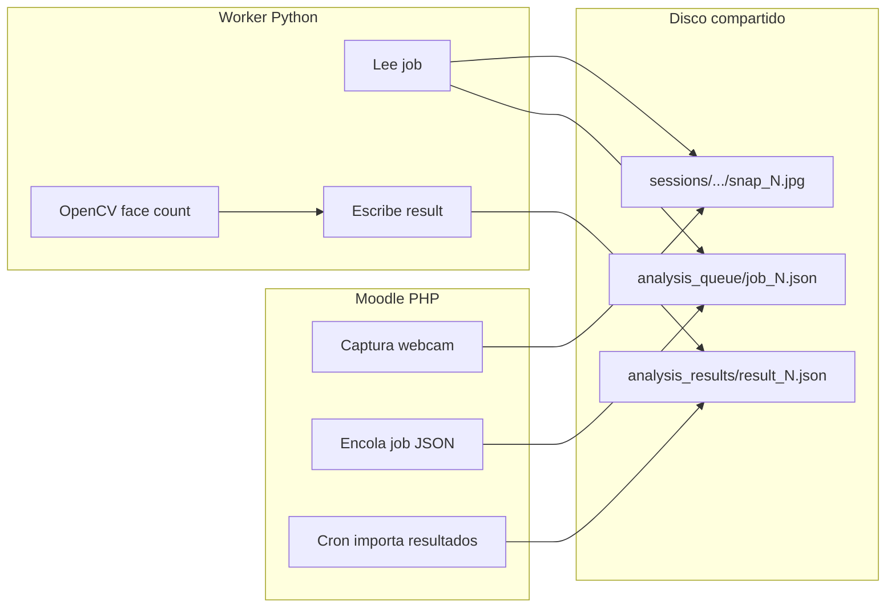
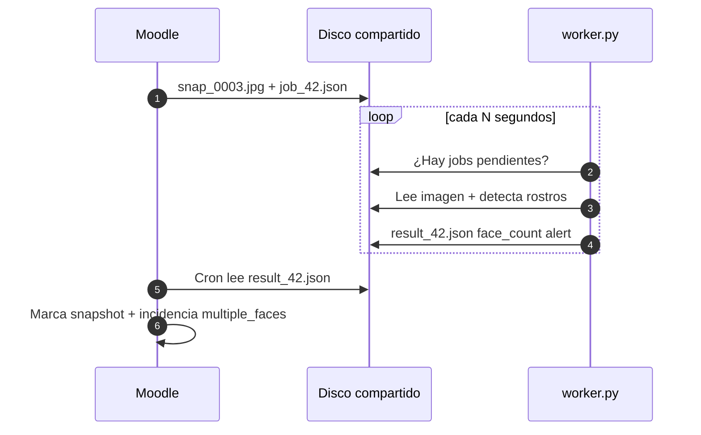

# Moodle Proctor — Python Worker

[](https://www.python.org)
[](https://opencv.org)
[](https://moodle.org)
[](https://github.com/Johnrivera7/moodle_proctor_python/tree/MOODLE_53)
[](https://github.com/Johnrivera7/moodle_proctor)
[](LICENSE)

Worker **independiente** para análisis facial (conteo de rostros en capturas). Compatible con **`local_moodle_proctor`** rama **MOODLE_53** (Moodle 5.3 / PHP 8.3+). Desde la v1.5 el núcleo trae Python embebido: este repositorio solo hace falta si se desactiva ese modo.

| | |
|---|---|
| **Autor** | [John Rivera](https://github.com/Johnrivera7) |
| **Contacto** | [johnriveragonzalez7@gmail.com](mailto:johnriveragonzalez7@gmail.com) |
| **Repositorio** | https://github.com/Johnrivera7/moodle_proctor_python |
| **Rama** | **`MOODLE_53`** |
| **Integración** | Cola JSON en disco compartido + `worker.json` (sin API HTTP) |

> 🐍 **Repo separado a propósito** — proceso aparte de PHP/Moodle; puede correr en el **mismo servidor** o en cualquier máquina que monte la **misma ruta compartida** (da igual el proveedor cloud).

> Moodle 5.2: rama [`MOODLE_52`](https://github.com/Johnrivera7/moodle_proctor_python/tree/MOODLE_52). Moodle 4.5: rama [`MOODLE_45`](https://github.com/Johnrivera7/moodle_proctor_python/tree/MOODLE_45).

---

## Nombrado de archivos (IDs, no hashes)

Python **no busca archivos por hash**. Moodle escribe un `job_{snapshotid}.json` que apunta a la imagen por ruta absoluta:

| Qué | Nombre | Significado |
|-----|--------|-------------|
| Captura quiz | `sessions/{course}/{quiz}/{attempt}/snap_0003.jpg` | Secuencia del intento |
| Job | `analysis_queue/job_42.json` | `snapshotid = 42` en Moodle |
| Resultado | `analysis_results/result_42.json` | Mismo ID de snapshot |

El worker lee `image` del JSON, cuenta rostros con OpenCV y escribe `face_count` / `alert` en el result. El cron de Moodle enlaza todo por `snapshotid`.

---

**No hay API HTTP.** Moodle y Python se comunican solo con archivos en la **misma ruta montada** — da igual si es disco local, NFS, NAS u otro almacenamiento compartido.





---

## ¿Dónde se instala?

| Escenario | Recomendación |
|-----------|---------------|
| **Un solo servidor Moodle** | ✅ Instalar **en el mismo servidor** (opción más simple) |
| **Varios nodos web + disco compartido** | Instalar en **cualquier nodo** que monte la misma ruta |
| **Desarrollo local** | Misma máquina con `/tmp/moodle_proctor` |

El worker **no expone puertos**. Lee/escribe archivos en la carpeta que Moodle configura.

---

## Configuración automática (v1.4.1+)

**No configure la ruta en Python.** Moodle la exporta al guardar ajustes:

| Paso | Quién | Qué pasa |
|------|-------|----------|
| 1 | **Admin Moodle** | Guarda **Storage path** = `/mnt/storage/{moodlehost}` |
| 2 | **Plugin local** | Escribe `/var/lib/moodle_proctor/worker.json` |
| 3 | **Worker Python** | Lee ese JSON al iniciar — **sin `--storage` en systemd** |

```json
{
  "storage": "/mnt/storage/campus.ejemplo.cl",
  "storage_template": "/mnt/storage/{moodlehost}",
  "wwwroot": "https://campus.ejemplo.cl",
  "updated": 1719234567
}
```

**Prioridad en Python:** `--storage` (override) → `MOODLE_PROCTOR_STORAGE` → `worker.json`.

---

## Requisitos

| Requisito | Versión |
|-----------|---------|
| Python | 3.9+ |
| OpenCV | `opencv-python-headless` ≥ 4.8 |
| Moodle (suite) | **5.3** con [`local_moodle_proctor`](https://github.com/Johnrivera7/moodle_proctor/tree/MOODLE_53) **v1.6.4** |
| Disco compartido | Misma ruta resuelta que Moodle (lectura/escritura `www-data`) |
| `worker.json` | Generado por Moodle al guardar ajustes |

---

## Instalación en el mismo servidor que Moodle

### 1 · Preparar carpetas

```bash
sudo mkdir -p /var/lib/moodle_proctor /mnt/storage
sudo chown www-data:www-data /var/lib/moodle_proctor /mnt/storage
sudo chmod 770 /var/lib/moodle_proctor /mnt/storage
```

### 2 · Clonar e instalar dependencias

```bash
sudo git clone -b MOODLE_53 https://github.com/Johnrivera7/moodle_proctor_python.git /opt/moodle_proctor_python
cd /opt/moodle_proctor_python
sudo python3 -m venv venv
sudo ./venv/bin/pip install -r requirements.txt
```

### 3 · Generar config desde Moodle

**Administración → Plugins locales → Moodle Proctor → Guardar.**

Comprobar **Sincronización con Python** = OK y que exista `/var/lib/moodle_proctor/worker.json`.

### 4 · Probar

```bash
sudo -u www-data /opt/moodle_proctor_python/venv/bin/python \
  /opt/moodle_proctor_python/worker.py --once
```

### 5 · Servicio systemd

El archivo incluido ya **no usa `--storage`**:

```bash
sudo cp /opt/moodle_proctor_python/moodle-proctor-worker.service /etc/systemd/system/
sudo systemctl daemon-reload
sudo systemctl enable --now moodle-proctor-worker
sudo journalctl -u moodle-proctor-worker -f
```

### 6 · Activar en Moodle

| Ajuste | Valor |
|--------|-------|
| **Habilitar cola de análisis Python** | Sí |
| **Habilitar análisis facial** | Sí |

---

## Cron alternativo (sin systemd)

```bash
# crontab -u www-data -e
* * * * * /opt/moodle_proctor_python/venv/bin/python /opt/moodle_proctor_python/worker.py --once
```

---

## Desarrollo local

```bash
git clone -b MOODLE_53 https://github.com/Johnrivera7/moodle_proctor_python.git
cd moodle_proctor_python
python3 -m venv venv && source venv/bin/activate
pip install -r requirements.txt

# Con worker.json de Moodle, o override:
python worker.py --storage /tmp/moodle_proctor --once
```

---

## Permisos

```bash
sudo chown -R www-data:www-data /mnt/storage /var/lib/moodle_proctor
sudo chmod -R 770 /mnt/storage /var/lib/moodle_proctor
sudo chown -R root:www-data /opt/moodle_proctor_python
sudo chmod -R 750 /opt/moodle_proctor_python
```

---

## Suite MOODLE_53

| Repo | Rol |
|------|-----|
| [moodle_proctor](https://github.com/Johnrivera7/moodle_proctor/tree/MOODLE_53) | Cola + `worker.json` |
| **moodle_proctor_python** | ← Worker |
| [moodle_quizaccess_proctor](https://github.com/Johnrivera7/moodle_quizaccess_proctor/tree/MOODLE_53) | Capturas |
| [moodle_block_proctor](https://github.com/Johnrivera7/moodle_block_proctor/tree/MOODLE_53) | Bloque |
| [moodle_proctor_extension](https://github.com/Johnrivera7/moodle_proctor_extension/tree/MOODLE_53) | Extensión |

Diagramas completos de arquitectura: [README del núcleo](https://github.com/Johnrivera7/moodle_proctor/blob/MOODLE_53/README.md).

---

## Licencia

GPL-3.0+ — [LICENSE](LICENSE)

## Soporte

- **Autor:** [John Rivera](https://github.com/Johnrivera7) · [johnriveragonzalez7@gmail.com](mailto:johnriveragonzalez7@gmail.com)
- **Issues:** https://github.com/Johnrivera7/moodle_proctor_python/issues
