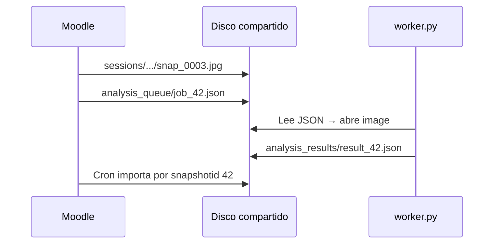

# Moodle Proctor — Python Worker

[](https://www.python.org)
[](https://opencv.org)
[](LICENSE)
[](https://github.com/Johnrivera7/moodle_proctor)
[](https://github.com/Johnrivera7/moodle_proctor_python/tree/MOODLE_45)
[](#systemd-recomendado)

Worker **independiente** para análisis facial en capturas. Se comunica con Moodle **solo por archivos en disco compartido** — no es un plugin Moodle ni expone HTTP.

| | |
|---|---|
| **Repositorio** | https://github.com/Johnrivera7/moodle_proctor_python |
| **Autor** | [John Rivera](https://github.com/Johnrivera7) |
| **Integración** | Cola JSON en disco compartido (misma ruta que Moodle) |

> 🐍 **Repo separado a propósito** — proceso aparte de PHP/Moodle; corre en el **mismo servidor** o en cualquier máquina con la **misma ruta montada** (AWS, Azure, GCP, NFS, local, etc.).

> Moodle 5.2+: rama [`MOODLE_52`](https://github.com/Johnrivera7/moodle_proctor_python/tree/MOODLE_52) con sync automático `worker.json`.

---

## Cómo funciona (IDs, no hashes)

Python **no busca imágenes por hash**. Moodle escribe `job_{snapshotid}.json` con la ruta absoluta de la captura:



| Archivo | Ejemplo |
|---------|---------|
| Captura | `sessions/3/7/12/snap_0003.jpg` |
| Job | `analysis_queue/job_42.json` |
| Resultado | `analysis_results/result_42.json` |

---

## Requisitos

| Requisito | Versión |
|-----------|---------|
| Python | 3.9+ |
| OpenCV | `opencv-python-headless` ≥ 4.8 |
| Disco compartido | **Misma ruta** que Storage path en Moodle |
| Usuario del servicio | Lectura/escritura en esa ruta (`www-data`) |

---

## Instalación

```bash
git clone -b MOODLE_45 https://github.com/Johnrivera7/moodle_proctor_python.git /opt/moodle_proctor_python
cd /opt/moodle_proctor_python
python3 -m venv venv
source venv/bin/activate
pip install -r requirements.txt
```

---

## Configuración en Moodle

**Administración → Plugins locales → Moodle Proctor**

- ✅ **Enable face analysis**
- ✅ **Enable Python analysis queue**

La ruta de almacenamiento debe ser **idéntica** en Moodle y en el worker (`--storage`).

---

## Uso

### Daemon continuo

```bash
python worker.py --storage /mnt/proctor
```

### Una pasada (cron cada minuto)

```bash
python worker.py --storage /mnt/proctor --once
```

### Análisis manual

```bash
python analyze_faces.py \
  --image /mnt/proctor/sessions/1/2/3/snap_0001.jpg \
  --output /tmp/result.json
```

---

## systemd (recomendado)

```bash
sudo cp moodle-proctor-worker.service /etc/systemd/system/
# Editar ExecStart: ruta --storage y venv
sudo systemctl enable --now moodle-proctor-worker
sudo systemctl status moodle-proctor-worker
```

---

## Salida JSON

```json
{
  "face_count": 2,
  "alert": true,
  "alert_reason": "multiple_faces",
  "snapshotid": 42,
  "processed": 1718467200
}
```

| `face_count` | Significado |
|:------------:|-------------|
| `0` | No detecta rostro — alerta |
| `1` | OK |
| `≥ 2` | Múltiples personas — alerta crítica |

---

## Suite Moodle Proctor

| Repo | Rol |
|------|-----|
| [moodle_proctor](https://github.com/Johnrivera7/moodle_proctor) | Genera cola + importa resultados |
| **moodle_proctor_python** | ← Este worker |
| [moodle_quizaccess_proctor](https://github.com/Johnrivera7/moodle_quizaccess_proctor) | Captura webcam |
| [moodle_block_proctor](https://github.com/Johnrivera7/moodle_block_proctor) | Bloque curso |
| [moodle_proctor_extension](https://github.com/Johnrivera7/moodle_proctor_extension) | Extensión |

---

## Licencia

GPL-3.0+ — [LICENSE](LICENSE)
